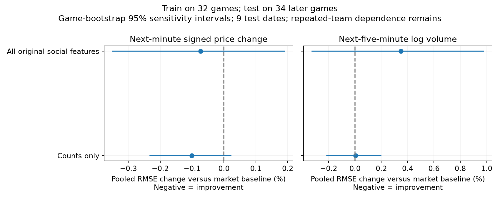
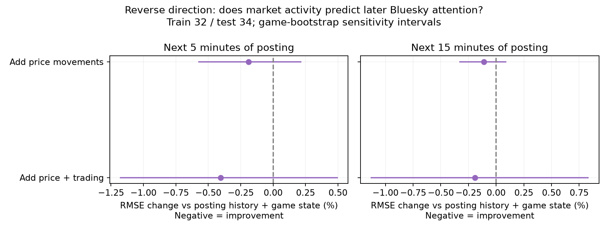
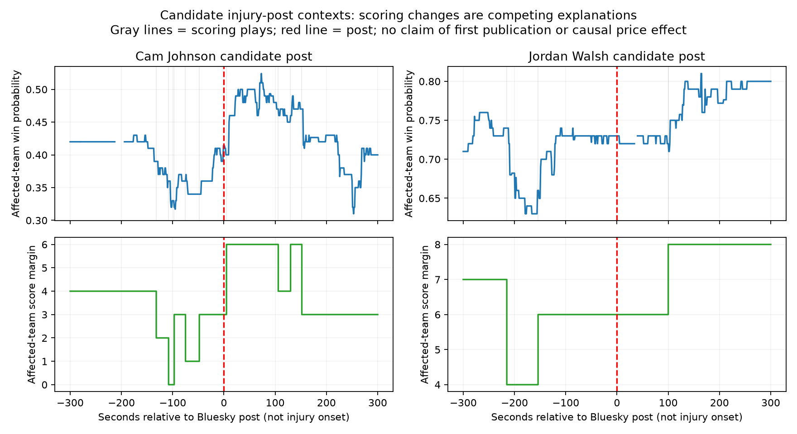

# Social attention and NBA prediction-market activity

Authors: **[students enter names and affiliations]**

AI-assisted methods scaffold. This is not a completed final paper. The course
requires the students to compose the introduction, findings, and conclusion
without AI assistance. Those sections are deliberately left for the authors.

## 1. Introduction — students write unaided

**[Authors supply the question, motivation, scope, and contribution.]**

## 2. Related research — reading notes to verify

Prediction-market research motivates treating market prices as a demanding
information-aggregation benchmark, while distinguishing forecasting from causal
identification. See Wolfers and Zitzewitz (2004), [*Prediction Markets*](https://www.nber.org/papers/w10504).

A particularly close comparison is Brown, Rambaccussing, Reade, and Rossi (2017),
[*Forecasting with Social Media: Evidence from Tweets on Soccer Matches*](https://ueaeprints.uea.ac.uk/64244/1/BetfairTwitterEI_revisedv2.pdf).
Their soccer/Twitter/Betfair study examines text tone and outcome information,
including reactions after major game events. Our query-count attention measures,
Bluesky platform, NBA setting, and price-increment targets are different; a result
about tone should not be described as a direct prediction about raw post counts.

Sultan and Morstatter (2026), [*The Conversation Turns First*](https://arxiv.org/abs/2609.28965),
is a recent preprint on Polymarket discussion and later market behavior. It
separates attention from directional content and reports predictive associations,
not causal effects. Its platform-native comments and longer horizons differ from
external, minute-level Bluesky discussion. Verify the preprint's status before
submission and avoid treating it as established peer-reviewed evidence.

Authors should read the cited sources, add full bibliography entries, and expand
this section with closely relevant sports-market and information-timing work.

## 3. Data and construction methods

The full analysis contains 66 NBA games in three sequential stages: eight original
development games, 24 later extension games, and 34 November replication games.
For each game, public Polymarket trade data, ESPN play-by-play, and Bluesky team
searches are aligned in UTC. Fixed collection windows begin two hours before
scheduled tip-off and end three and a half hours afterward. Model targets are
restricted using exact ESPN first/final-play timestamps, excluding the final
partial minute where end-of-minute trades could occur after the recorded finish.

The market price is the last trade in the minute, expressed as home-win probability,
with the existing CLOB fallback and flagged forward fill. Log-odds use probabilities
clipped to [0.01,0.99]. Team tokens are mapped by labels, and trade identities are
checked. ESPN supplies scores, scoring plays, and game time remaining. Historical
last-trade prices can contain bid–ask effects; they are not executable mid-prices.

Bluesky searches use the existing team queries and the 100-result splitting helper.
Successful empty searches contribute zeros; failed/truncated coverage contributes
missing values. Posts are deduplicated by game, side, and URI. The primary pilot
timestamp rule is the minimum of creation and indexing times. A sensitivity keeps
only posts whose two timestamps both precede the original minute's cutoff. This
is an index-confirmed subset, not a complete indexed-time collection.

Social features are raw team counts, abnormal log-counts relative to the 120-minute
pre-tip mean, home–away imbalance, and broad injury-keyword counts. Matching a query
does not establish relevance to the particular game, factual accuracy, novelty, or
which team has an injured player. A post matching both queries contributes to both
side counts; inventories also report distinct game/post pairs.

**[Authors insert the completed content-validation protocol and results after
reviewing `social_validation_sample.csv`. Do not substitute provisional AI labels
for independent human validation.]**

## 4. Evaluation methods

### Forward direction

The primary price target is the next-minute change in home-win log-odds, with a
five-minute sensitivity. Baselines include no change and a regression using market
history plus game state. Social augmentations use either the original complete
feature bundle or counts only. A secondary activity task forecasts log(1 + USDC
volume over the next five minutes), with a fifteen-minute sensitivity and matched
trailing-volume persistence benchmark. Target intervals begin after the feature
minute and must end before the recorded game finish.

### Reverse direction

The reverse target is log(1 + the sum of query-side posts over the next five or
fifteen minutes). Its baseline includes recent posting activity, score margin,
time remaining, and recent scoring. One augmentation adds current/five-minute
absolute price changes; another adds trading-volume, trade-count, and order-flow
features. This asks whether market data add incremental forecast information beyond
posting history and observable game state, without assigning causal direction.

### Training, test stages, and uncertainty

The eight-game analysis uses leave-one-game-out development comparisons. The next
stage fits only those eight and evaluates on 24 later games selected by scheduled
time. The broader replication fits on the 32 earlier games and evaluates on up to
four games per available date during November 1–10, selected without price-movement,
volume, or social-activity thresholds. The resulting 34 games span nine dates.
Designs were committed before test scoring. The early reverse-direction analysis
was exploratory; its specification was then frozen before the November replication.

Standardization is fitted on training data only. Ridge alpha=1 is the primary
estimator and OLS a sensitivity; no test-based hyperparameter tuning occurs.
Nonnegative volume/posting forecasts are clipped at zero. The main score is pooled
RMSE, accompanied by equal-game RMSE, MAE, per-game errors, and persistence comparisons.
Paired bootstrap checks resample games and dates, with 10,000 draws and seed 473.
These are sensitivity intervals rather than exact independent-sample guarantees:
teams and dates recur, and multiple tasks/specifications are examined.

The original extension's final-minute boundary correction followed inspection of
its first test run; pre-correction artifacts are retained. Its correction was in
place before November replication scoring. No outcomes or specifications were
discarded because they looked unfavorable.

## 5. Findings — students write unaided

**[Authors inspect the saved tables/figures, choose the main comparisons, and
write their own findings and interpretation. Distinguish all-feature models from
counts-only sensitivities, and primary comparisons from exploratory analyses.]**

Artifact references:

Numerical inventories and caveats: [`final_project_status.md`](final_project_status.md).
Full per-game and aggregate tables: `data/processed/final_replication/`.

## 6. Limitations and robustness — authors develop

Document search coverage and semantic ambiguity, game/date/team dependence,
timestamp uncertainty, price-definition sensitivity, lack of historical order-book
execution, multiple comparisons, retrospective sampling, and the distinction
between prediction and causation. Report what changes under the timestamp subset,
OLS, longer horizons, and the earlier sample rather than choosing a single winner.

## 7. Conclusion — students write unaided

**[Authors supply the conclusion and scope of supported claims.]**

## References and reproducibility appendix — authors finalize

Provide complete citations for the sources above and the data APIs. Include the
repository/version used, environment and commands, data-selection rules, exclusions,
timing convention, and a truthful AI-use and individual-contribution statement.

Reproduction commands and frozen design files are documented in
[`final_replication_methods.md`](final_replication_methods.md).
