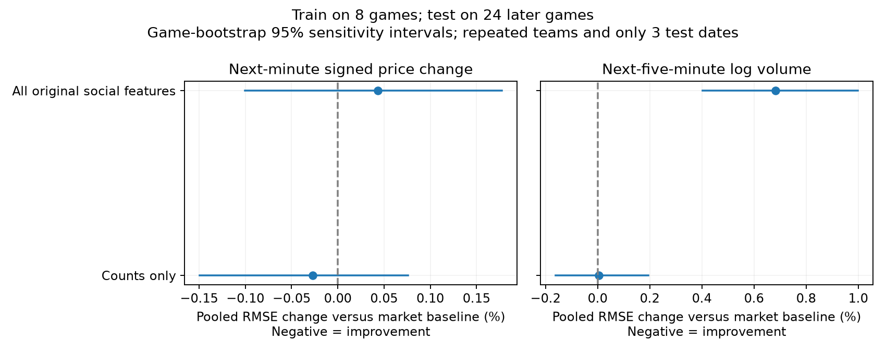

# Final-project extension: methods and evidence handoff

Prepared November 11, 2026. This is an AI-assisted technical handoff and numerical
validation record, not final-paper introduction, findings, or conclusion prose.

## What has advanced beyond Milestone II

- The dataset now includes **32 games**: the original eight development games and
  24 later test games. Pilot data and results were not overwritten.
- The later sample was selected by scheduled time and slug, without volume,
  posting-activity, or forecasting-success thresholds. It covers October 28–30,
  not all dates through November 10: the frozen rule selected the first 24 games
  from that larger permitted date range.
- Models train only on the original eight games; no later-game outcome is used
  for fitting, scaling, tuning, or model selection. This is a retrospective
  chronological holdout, not evidence of a live deployed trading strategy.
- A secondary activity experiment forecasts next-five-minute log total USDC
  volume. Counts-only, OLS, fifteen-minute volume, five-minute price, and a
  conservative timestamp-subset check are declared sensitivities.
- A new outcome-blind human review sample contains 100 actual-game-time posts
  with representation from all eight development games. Its labels remain blank
  pending review; semantic quality has not been declared solved.

## Frozen design and transparent corrections

`final_social_design.json` was committed at `e73d81b` before new-game collection
and scoring. The collection/evaluation implementation was committed at `7f947ad`
before scoring. This is an internal analysis freeze, not external preregistration.
The pilot outcomes and exploratory volume/magnitude results were already known;
only the later sample was previously unevaluated.

All 24 originally selected games were ultimately collected. Two initially failed
an ESPN full-name match because ESPN uses "LA Clippers" rather than "Los Angeles
Clippers". A narrowly tested alias fixed that matching error; games were not
replaced. The original 192 MB metadata response is preserved losslessly as a
17 MB gzip cache, with compression round-trip equality checked.

The first holdout run used the original inclusive game-minute flag. A subsequent
timing review identified that its final partial minute could include trades after
the recorded final play. The corrected evaluation requires each minute's cutoff
to be no later than ESPN's exact final-play timestamp and after actual tip-off,
for both training and test data. Its future targets therefore exclude the final
partial minute. This correction was made after the first holdout outcomes had
been inspected; it is not concealed as an untouched first analysis. Original
pre-correction artifacts remain under `final_social/pre_boundary_correction/`.
No features, hyperparameters, games, or model families were selected based on the
correction's effects. ESPN timestamps themselves may have logging delay.

## Coverage and feature definitions

Later-game raw caches are under `data/raw/final_social/`; derived data and model
outputs are under `data/processed/final_social/`. They contain 7,920 game-minute
rows, with both Bluesky query sides successfully covered in every row, and 3,133
deduplicated post-side rows over the full pre/post-tip windows. The market file
contains 3,409 inclusively flagged game minutes before exact-boundary trimming,
and ESPN provides 2,828 scoring plays. Posting counts still measure keyword
matches, not verified event-specific information.

Primary price target: next-minute signed home-win log-odds change. Secondary
activity target: log(1 + total USDC volume) during the next five complete minutes.
Prices use the existing last-trade/fallback hierarchy and [0.01,0.99] logit clip.
The strict target alignment uses features through the end of minute t and only
future observations from t+1 onward. Both tasks compare market and game-state
predictors against the same predictors plus the original social feature bundle.
The counts-only model is separately reported, not silently substituted when it
looks better. Ridge alpha=1 is the declared main estimator; OLS is a sensitivity.
Nonnegative volume predictions are clipped at zero for all fitted volume models.

The corrected one-minute price and five-minute volume samples each contain 3,265
test rows across all 24 games; fifteen-minute volume has 3,025. The input and
eligible sample sizes are distinct and should be labeled accordingly.

## Numerical validation table for authors

This table describes the corrected, ridge, pilot-sort-time run. Negative percent
change means lower pooled RMSE than the market-only baseline. Intervals are
whole-game bootstrap sensitivity intervals, not confirmatory significance tests.

| Target | Social feature set | RMSE change versus market (%) | Game-bootstrap interval (%) | Games improved |
|---|---|---:|---|---:|
| Next-minute signed price | All original features | +0.043 | [−0.101, +0.177] | 13/24 |
| Next-minute signed price | Counts only | −0.027 | [−0.149, +0.076] | 14/24 |
| Next-five-minute log volume | All original features | +0.684 | [+0.403, +0.998] | 6/24 |
| Next-five-minute log volume | Counts only | +0.004 | [−0.161, +0.194] | 11/24 |



All held-out predictions, per-game errors, both pooled and equal-game summaries,
and the other declared sensitivities are saved. The market-versus-persistence
comparison is also retained. The earlier eight-game volume/magnitude development
experiment is retained under `social_activity_development_*`; it is not described
as fresh test evidence. In that development experiment the full social bundle
substantially worsened volume errors, which is why a guaranteed improvement was
never an appropriate success criterion.

## Uncertainty and interpretation limits

Paired bootstrapping resamples complete test games, with an additional date-cluster
sensitivity, using 10,000 draws and seed 473. Test games share teams and span only
**three dates**, so neither set of intervals should be advertised as an exact
independent-sample confidence guarantee. Models are fixed before test scoring and
not retrained per bootstrap draw. Many sensitivity comparisons are reported; the
plots do not establish a causal relationship or first publication of information.

The development review found 22 of 951 distinct in-game posts indexed after their
original minute ended, along with some negative timestamp differences. A
conservative sensitivity removes posts unless both creation and indexing times
precede the end of their original bin; baseline abnormal attention is recalculated
from those counts. It retains original query-window coverage and is explicitly a
subset, not a complete feed rebinned on indexed time. Neither timestamp proves
when a trader learned the information.

## Remaining work that cannot be claimed completed

1. Students review the 100-post relevance/content sample using
   `social_annotation_guide.md`, preferably with an independently labeled overlap.
   Publish the protocol, reviewer identities, disagreements, and resulting label
   counts. The sampling is game-balanced, not volume weighted.
2. Independently verify sources and chronology for the candidate injury incidents.
   A broadcast-attributed post is not evidence that Bluesky first broke the news.
3. If cleaned content features are developed after examining these test results,
   reserve still-later unexamined games for another test. Do not reuse these 24 as
   a supposedly untouched holdout for subsequent model changes.
4. Students write the introduction, findings, and conclusion unaided as required
   by the course; add names/contributions and incorporate the verified evidence.
5. Broaden the test-date span and investigate executable prices/spreads only if
   the final paper makes trading-value claims. No trading profitability is claimed
   by this forecast experiment.

## Literature anchors to read and cite accurately

- Wolfers and Zitzewitz, *Prediction Markets* (2004), discusses information
  aggregation and the interpretation and design of market forecasts.
  [NBER working paper](https://www.nber.org/papers/w10504).
- Barber and Odean, *All That Glitters: The Effect of Attention and News on the
  Buying Behavior of Individual and Institutional Investors* (2008), studies
  attention-driven buying in equities. It motivates separating attention/activity
  from directional information, but does not establish a Bluesky/NBA effect.
  [Authors' paper record](https://papers.ssrn.com/sol3/papers.cfm?abstract_id=1151595).

These are starting references, not a completed literature review of sports social
media or a claim that equity-market mechanisms necessarily transfer to this setting.

## Reproduction

```bash
python scripts/prepare_social_validation.py
python scripts/run_social_activity.py
python scripts/collect_final_social.py
python scripts/evaluate_final_social.py
python scripts/plot_final_social.py
python -m pytest -q tests
```

Use Python 3.11 and the existing requirements. Collection uses isolated caches;
evaluation writes only the final extension outputs. The original Milestone II
tables and submitted-model comparisons remain unchanged. The synthetic suite
contains 35 passing tests, including future-volume timing, no cross-game borrowing,
timestamp sensitivity, the Clippers alias, and exact-buzzer-boundary handling.
