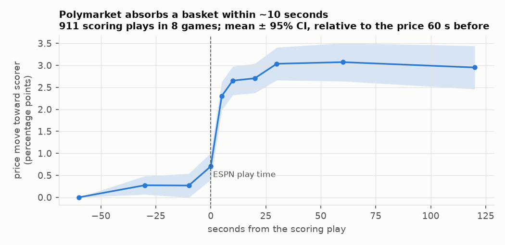
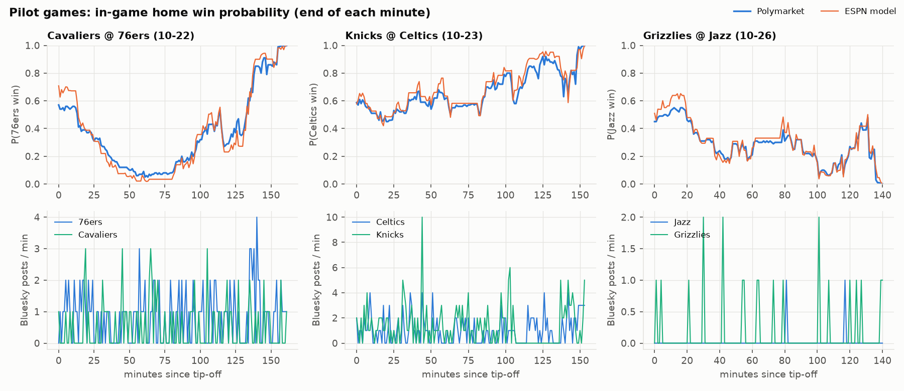
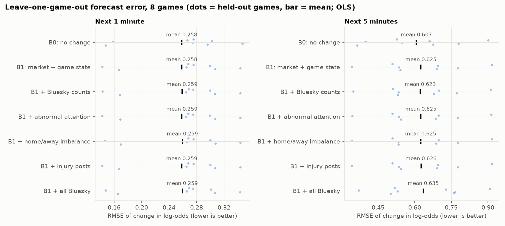
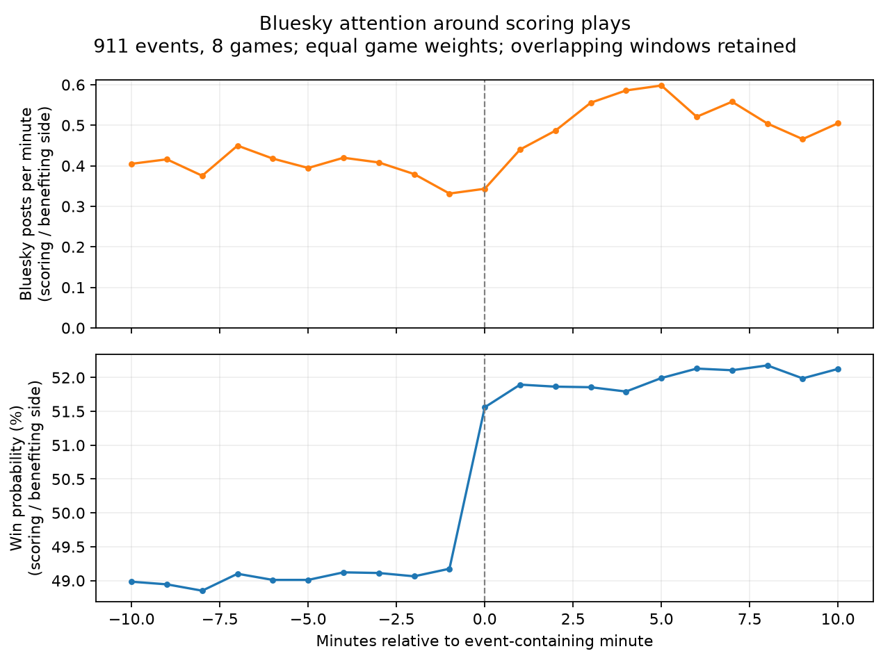
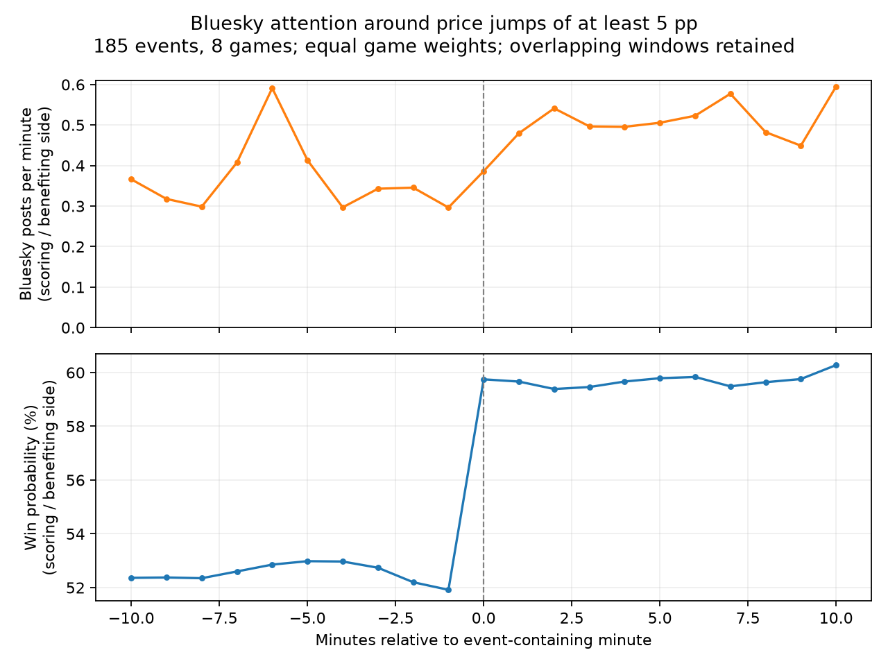
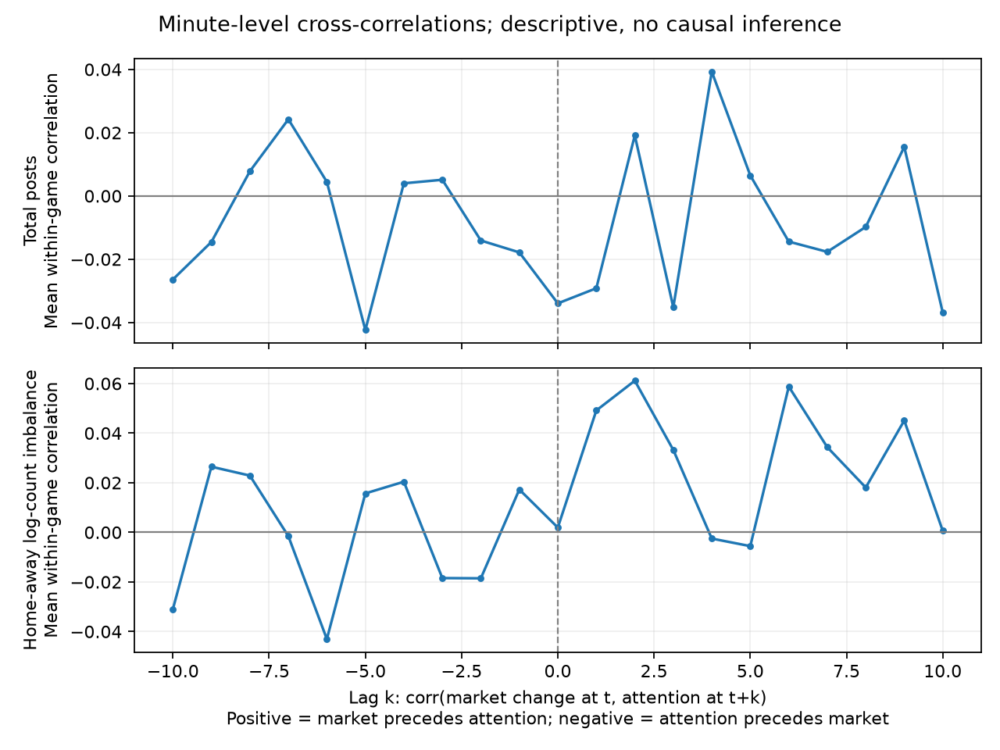
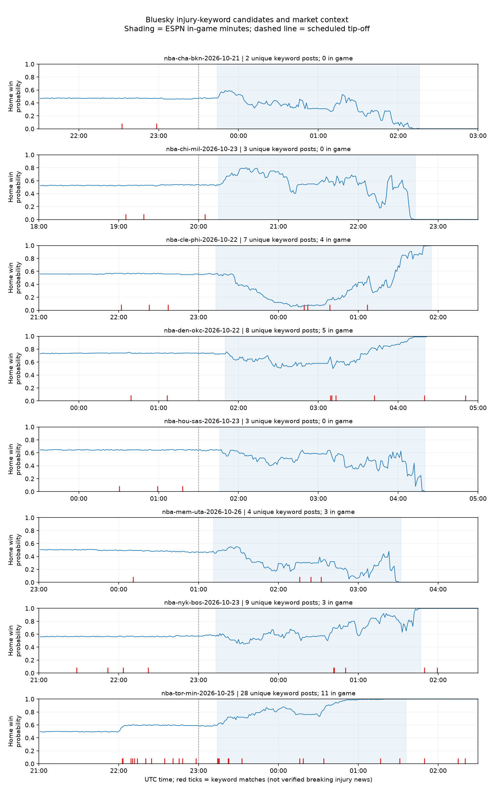
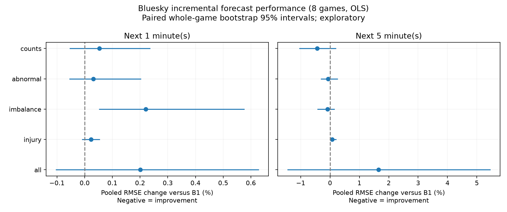

# Social Media and In-Game Prediction-Market Prices: Milestone II Report

*ECE 473 · Milestone II · November 12, 2026 · [names]*

## Summary
**Milestone II goal (from our proposal):** expand and clean the dataset, complete the primary empirical analysis, compare market-only models with models that add social-media information on held-out events, and run initial robustness checks across time horizons and alternative attention measures.

Following the feedback on Milestone I, we moved the analysis **inside the games**, at one-minute resolution, and use **one social-media source (Bluesky)**.

| Milestone II item | Status | Section |
|---|---|---|
| Expanded, cleaned dataset | Done: 8 NBA games, 1,203 in-game minutes, 37,810 trades, 911 scoring plays, Bluesky posts per minute | 2 |
| Market-only vs. social-media models on held-out games | Done: leave-one-game-out, 3 pilot games, then all 8 | 4 |
| Robustness: horizons, attention measures | Done: 1 vs. 5 minutes; 4 attention measures; 2 estimators; 2 price definitions | 5 |
| Main result established | Yes, for this sample (below) | 4 |

**Main findings.**
1. **The market absorbs game events within seconds.** After a basket, the Polymarket price moves about 3 percentage points toward the scoring team, most of it within 5–10 seconds (Section 3).
2. **Nothing beats "no change" one minute ahead.** Neither the market's own recent history nor the score adds predictive power once prices are measured at the end of each minute.
3. **We found no detectable forecasting gain from Bluesky.** None of the four attention measures measurably improves out-of-sample forecasts at 1 or 5 minutes, in the 3 pilot games or in all 8 (Section 4).

Bluesky activity is sparse: an average of 0.44 posts per minute per team, and none at all in most minutes. The market prices events within seconds, faster than minute-level Bluesky counts can capture.

## 1. Response to the Milestone I feedback
| Feedback | What we changed |
|---|---|
| One social-media source is enough | We use Bluesky only. GDELT is dropped; its 15-minute files are too coarse for in-game analysis anyway. |
| Why that prediction horizon? Most information arrives during the game, and markets absorb it in seconds | We moved from hourly pregame data to **in-game data at one-minute resolution**, with a 5-minute check. We also measured the market's reaction to scoring plays **to the second** (Section 3). We chose one-minute bins to balance alignment with game events against sparse posting. Bluesky posts have finer timestamps; one minute is our analysis choice, not an API resolution limit. |
| Show results on a few games before expanding | Results are reported first for 3 pilot games (Cavaliers @ 76ers, Knicks @ Celtics, Grizzlies @ Jazz), then for all 8. |
| What is the main metric? | **RMSE of the next-minute change in the log-odds of the home team winning**, on held-out games. A Diebold–Mariano test checks whether differences are real. Secondary metrics are MAE and the share of moves whose direction is predicted correctly. |
| What is the baseline? | **B0:** no change, a persistence benchmark. **B1:** a regression on the market's recent price changes, trades and buy/sell pressure, plus the game state: score margin, points just scored, time remaining, and the gap between ESPN's win probability and the market price. |
| How does the media data enter the price? | Bluesky measures are added to B1 as predictors of the next change in log-odds. The forecast probability is p̂(t+1) = logistic(logit p(t) + predicted change). Bluesky helps only if this forecast beats B1's on held-out games. |

## 2. Data
**Games.** These are the same 8 opening-week NBA games as in Milestone I, chosen for liquidity, with each team appearing only once. For each game we cover the window from 2 hours before the scheduled tip-off to 3.5 hours after it, and analyse the minutes between the actual tip-off and the final buzzer.

| Source | What we use | Notes |
|---|---|---|
| Polymarket | every trade in each game's moneyline market (37,810 in-game trades) | Polymarket retired its old trades API in November. The new one returns exactly the same pregame trades for all 8 games. |
| ESPN | every play with its real-world (wall-clock) time, score, points, game clock and ESPN's win probability | 911 scoring plays |
| Bluesky | posts mentioning each team, counted per minute | Collected with the Milestone I search terms. All 2,640 game-minutes were retrieved successfully. |

**Price at the end of each minute.** We use the **last trade of the minute**, converted to the home team's win probability. Trades exist in 96–100% of in-game minutes. Polymarket's minute-level price history is irregular, with gaps of up to 6 minutes, so it serves only as a fallback.

The choice matters. Using the minute's *average* price instead makes the baseline look 17% better than "no change" (p < 0.001), but that is an artifact: a basket scored late in the minute only shows up in the next minute's average. With end-of-minute prices the apparent predictability disappears (Section 4).

**Checks:**
- In every game, the price ends near 1 for the team that won.
- The price tracks ESPN's win probability closely, with correlation 0.93–0.98 (Figure 2).
- Every trade belongs to the correct market.
- The merged table has one row per game-minute, with no duplicates or gaps.
- All 9 earlier tests and 4 new market-side tests pass. Separate tests cover the Bluesky side.

**Bluesky activity is sparse.** During games, only 42% of minutes contain any post about either team, an average of 0.44 posts per minute per team. Activity ranges from 6 posts in total (Hornets @ Nets) to 352 (Knicks @ Celtics). The injury rule matched 37 in-game post-side rows, representing 26 distinct posts. A post matching both teams’ queries contributes to both side counts; these are keyword matches, not verified new injury events.

## 3. How fast does the market react?
For each of the 911 scoring plays, we compare the price at moments around ESPN's timestamp with the price 60 seconds before the play.

The price barely moves beforehand: about 0.3 points from 30 to 10 seconds before the play. By 5 seconds after the play it has moved 2.3 points, by 10 seconds 2.65, and it levels off at about 3 points within 30 seconds.

The small rise before ESPN's timestamp may reflect ESPN recording plays a few seconds late. A market that absorbs a basket within seconds leaves nothing for minute-level information to predict about scoring.

## 4. Main results
Each model is trained on all games but one and tested on the held-out game, repeated for every game. **RMSE** is the average over held-out games; lower is better. In brackets: the change in pooled RMSE against the comparison model (B0 for B1, B1 for the Bluesky models), the Diebold–Mariano p-value, and the number of held-out games where the model was better. The sample is 1,163 in-game minutes (442 in the pilot).

The RMSE values are averages over the held-out games, while the percentage changes and p-values are computed over all held-out minutes pooled. We test on held-out games, not forward in time.

**All 8 games**

| Model | Next minute: RMSE | Next 5 minutes: RMSE |
|---|---|---|
| B0: no change | 0.258 | 0.607 |
| B1: market + game state | 0.258 (−0.04%, p = 0.97, 5/8) | 0.625 (+2.60%, p = 0.16, 4/8) |
| B1 + Bluesky counts | 0.259 (+0.05%, p = 0.67, 4/8) | 0.623 (−0.44%, p = 0.21, 5/8) |
| B1 + abnormal attention | 0.259 (+0.03%, p = 0.78, 5/8) | 0.625 (−0.06%, p = 0.75, 4/8) |
| B1 + home/away imbalance | 0.259 (+0.22%, p = 0.01, 1/8) | 0.625 (−0.09%, p = 0.61, 4/8) |
| B1 + injury posts | 0.259 (+0.02%, p = 0.10, 2/8) | 0.626 (+0.07%, p = 0.24, 2/8) |
| B1 + all Bluesky | 0.259 (+0.20%, p = 0.46, 4/8) | 0.635 (+1.65%, p = 0.34, 4/8) |

**3 pilot games**

| Model | Next minute: RMSE | Next 5 minutes: RMSE |
|---|---|---|
| B0: no change | 0.315 | 0.705 |
| B1: market + game state | 0.331 (+5.14%, p = 0.03, 0/3) | 0.812 (+15.81%, p = 0.02, 0/3) |
| B1 + Bluesky counts | 0.333 (+0.44%, p = 0.13, 0/3) | 0.839 (+3.62%, p < 0.01, 1/3) |
| B1 + abnormal attention | 0.332 (+0.25%, p = 0.34, 0/3) | 0.820 (+1.03%, p = 0.06, 1/3) |
| B1 + home/away imbalance | 0.334 (+0.76%, p = 0.13, 0/3) | 0.810 (−0.45%, p = 0.53, 2/3) |
| B1 + injury posts | 0.332 (+0.13%, p = 0.05, 1/3) | 0.814 (+0.19%, p = 0.06, 0/3) |
| B1 + all Bluesky | 0.345 (+4.34%, p < 0.01, 0/3) | 0.900 (+12.21%, p < 0.01, 0/3) |

**Interpretation:**
- **Market and game-state information does not predict the next minute.** On all 8 games, B1 equals B0 (−0.04%, p = 0.97). The market has already absorbed the score and its own recent moves.
- **The pilot shows overfitting.** With only two training games per fold, B1 is significantly *worse* than "no change" (p = 0.03 at 1 minute, 0.02 at 5 minutes).
- **No Bluesky measure measurably improves the forecasts.** No attention measure significantly improves on B1 at either horizon. The largest 5-minute gain is 0.44% (p = 0.21). The home/away imbalance is nominally worse at 1 minute (Diebold–Mariano p = 0.01), but a game-level test corrected for the 10 feature sets we tried gives p = 0.23.
- **Adding all Bluesky features at once** hurts most at 5 minutes and in the pilot, which is consistent with fitting noise.
- **Overall:** with these 8 games, we find no evidence that Bluesky attention improves forecasts of Polymarket's next price moves beyond what the price already reflects. With only 8 games, small effects could still go undetected.

## 5. Robustness
- **Horizon:** the conclusions are the same at 1 and 5 minutes.
- **Attention measures:** we tested raw counts, abnormal attention (log posts minus the pre-game average), home-vs-away imbalance, injury-keyword posts, and all four combined. None helps.
- **Estimator:** ridge regression gives the same conclusions as OLS. Every comparison has the same direction and the same significance at the 5% level.
- **Price definition:** with the within-minute average price, B1 appears to beat "no change" by 17% at 1 minute (p < 0.001, 7 of 8 games). As explained in Section 2, this is a timing artifact, so the end-of-minute price is our main specification.
- **Sample:** the 3 pilot games and all 8 games agree.

## 6. Timing of Bluesky activity vs. the market
**Methods and artifacts.** We align Bluesky counts with ESPN scoring plays and end-of-minute market prices. Each event window runs from −10 to +10 minutes; minute 0 contains the event. For scoring plays, prices and posts are oriented toward the scoring team. For price jumps of at least 5 percentage points, they are oriented toward the team whose price increased. All 911 scoring-play windows and 185 price-jump windows have complete price and oriented-side posting coverage. We average events within games, then weight the eight games equally. Overlapping windows are retained, so individual event windows are not independent observations.

Cross-correlations use `corr(Δlogit_price(t), attention(t+k))`, calculated within each game, then averaged equally across games. Positive lag means market changes precede measured attention; negative lag means attention precedes market changes. Exact timestamp pairs are used, and price differences never bridge a missing minute or a carried-forward price. We include total posts and home–away log-count imbalance. A signed price change paired with unsigned total attention can obscure directionally opposing responses, so these are descriptive checks rather than an exhaustive test of dependence.

Minute-level binning cannot order two reactions within the same minute. Shared scoring shocks, repeated events, and selecting events by observed price jumps prevent a causal interpretation. The underlying curves, per-game values, event lists, and counts are saved in `figures/fig_m2_timing_*.csv` and `fig_m2_cross_correlation*.csv`. **The students should supply their own interpretation of these artifacts.**

## 7. Bluesky data quality

**Coverage and features.** The collector uses the existing team queries, with no additional nicknames. All 96 requested windows succeeded. The export contains 2,640 game-minute rows (330 per game) with both sides covered; this includes two pre-tip hours and a fixed 3.5-hour post-tip window. Only the ESPN-derived game interval is used for modeling. The posts table contains 1,986 deduplicated post-side rows across the full windows. Posts are binned using `sort_at = min(created_at, indexed_at)` and deduplicated on game, side, and URI. Successful empty searches are zero; failed/truncated coverage is missing. Avoiding the search cap is not proof of exhaustive search indexing.

Raw counts measure query matches. Abnormal attention subtracts the mean log-count over the 120 pre-tip minutes and is used only for forecasts at or after tip-off. Imbalance is the difference in home and away log-counts. Injury counts use the agreed broad keyword rule. These measures do not independently establish sentiment, factual accuracy, or which team suffered an injury.

**Provisional relevance review.** Fifty post-side rows were randomly sampled from the fixed post-tip window with seed 473. The AI-assisted text-only review labeled 24 clearly game-relevant, 16 unclear, and 10 unrelated or general discussion. This is **not an independently human-validated 48% relevance estimate**. The sampling window can include post-buzzer posts, and standalone texts can omit context contained in replies, images, or links. Labels and reasons are in [`relevance_sample.csv`](../data/raw/bluesky_ingame/relevance_sample.csv). Student review and actual-game-time resampling remain outstanding before reporting a final in-game relevance percentage.

**Injury audit.** Across the full windows, 92 injury-keyword post-side rows reduce to 64 distinct post/game pairs; 26 distinct posts fall during game time. The AI-assisted audit records seven literal-keyword false positives, ten repetitions of existing availability information, four general/hypothetical discussions, one generic report, two ambiguous reactions, and two potential live injury/symptom posts among the 26. These are provisional text categories, not verified diagnoses or breaking-news events. The unchanged broad features remain the inputs to the original models. The two live candidates require independent source and timestamp verification before any claim about information leadership.

The original annotations are preserved in [`injury_review.csv`](../data/raw/bluesky_ingame/injury_review.csv), and the full collection/feature methods are in [`milestone2_bluesky_methods.md`](milestone2_bluesky_methods.md).

### Additional model-validation methods

The supplemental evaluation saves each held-out forecast and explicitly separates mean game RMSE from pooled RMSE. It reproduces the 56 standard pilot/all-game model summaries to numerical precision. A stricter sample requires every price from five minutes before through five minutes after each forecast row to be observed; features are constructed before filtering to preserve lag alignment. This leaves 1,152 rows versus 1,163 in the primary sample.

Paired whole-game bootstrapping (10,000 draws, seed 473) provides sensitivity intervals without treating minutes as independent. Game-level sign-flip checks and a Holm adjustment cover the five social feature sets at both horizons, separately within each estimator/sample. Eight games and overlapping training folds limit inferential precision; these are exploratory checks, not definitive confirmatory inference. Details, numerical tables, and interpretation cautions are in [`enhanced_model_validation.md`](enhanced_model_validation.md).

## 8. Limitations
1. **Small sample.** There are 8 games and 1,163 model minutes, so small effects could go undetected. We have not run a formal power analysis.
2. **Sparse Bluesky signal.** Fewer than one post per minute per team, and only part of it about the game. Bluesky is much smaller than X/Twitter, where most real-time sports discussion happens.
3. **Minute resolution for Bluesky.** The market reacts within seconds, so information Bluesky shares *within* the same minute as a market move cannot be ordered at this resolution.
4. **Timestamps.** ESPN's play times may lag the actual events by a few seconds, and Bluesky timestamps record when a post was created or indexed, not when the poster learned the information.
5. **Prices.** The last trade price includes the bid–ask spread; we do not have historical order books.
6. **Prediction, not causation.** Shared events drive both markets and posts.

## 9. Next steps (presentation, Nov 17, and final paper)
1. **Information that is not in the score.** Injuries, lineup changes and ejections are where social media could plausibly lead the market. We will test these as hand-checked events, not keyword counts.
2. **The reverse direction.** Do large price moves predict later Bluesky activity? The proposal plans this for the final paper.
3. **More games.** The pipeline already handles any NBA game with a Polymarket market.
4. **Live recording for future games.** Polymarket's order book plus the full Bluesky stream would give exact timestamps and mid-prices.
